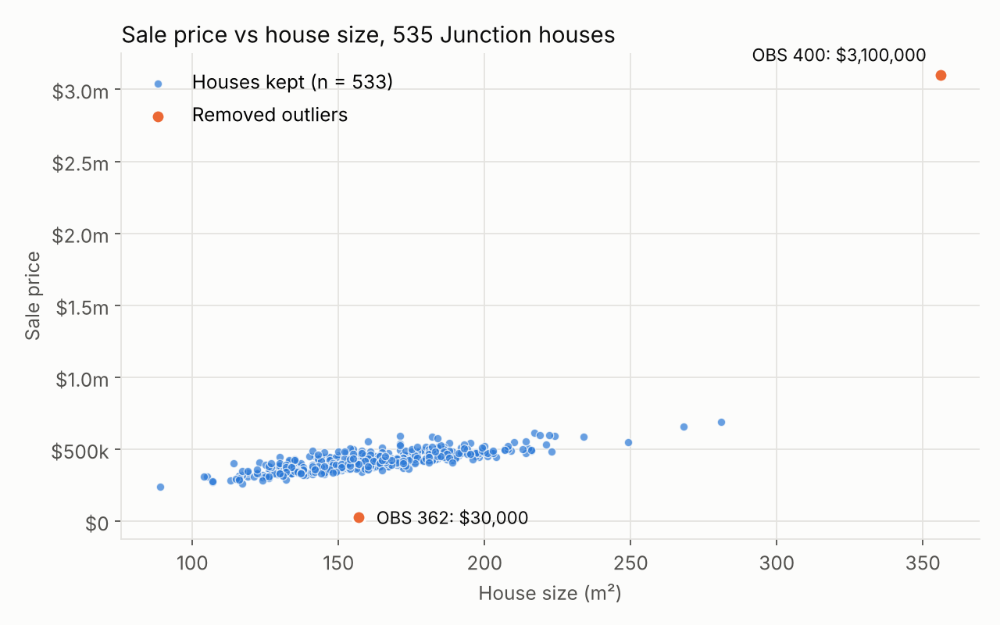
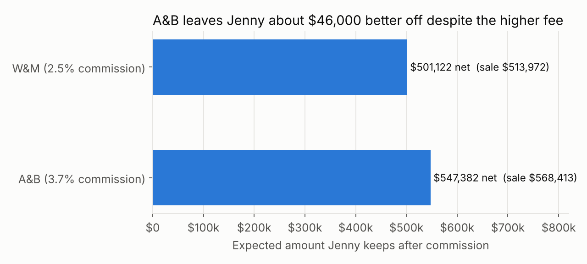
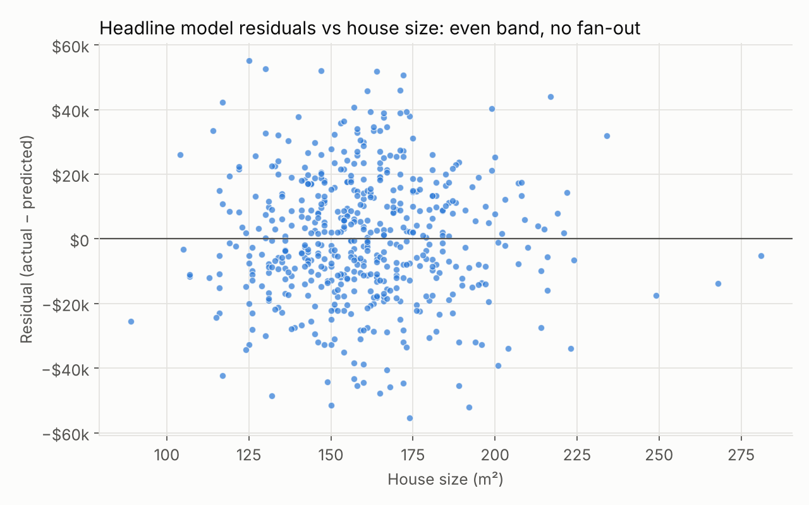

# House Price Prediction & Agent Recommendation

Regression analysis in Stata that predicts the sale price of a house in the fictional town of Junction and advises the owner which of two real estate agents to sell through. Group major project for Business Statistics, Master of Business Analytics, Adelaide University (Semester 2, 2026).

## Business problem

Jenny owns a two-storey, 153 m², 9-year-old house in the suburb of Claygate with a tennis court and an ocean view. She asked for:

1. A point prediction of the sale price
2. A 95% interval for that price
3. The marginal effect of house size on price
4. Advice on which agent to use: **W&M** (2.5% commission) or **A&B** (3.7% commission)

She also asked for a model with an R² of at least 89%.

## Data

> The dataset was provided by Adelaide University for coursework and is not included in this repository.

- 535 house sales in Junction, 2020–2025, with 14 variables: price, age, size, storeys, suburb, crime rate, distance to town, sale year, selling agent, and pool, tennis court, ocean view and shops indicators
- No missing values, but several data problems:
  - **OBS 362** sold for $30,000, far below the 1st percentile ($280,993). It is most likely a data-entry error.
  - **OBS 400** sold for $3.1m and is the only 4-storey house. It is an extreme outlier and nothing like Jenny's house.
  - **SHOPS** should be 0/1, but 29% of values are 2 or 3.
  - **SUBURB, CRIME and TOWN** are perfectly collinear (|r| = 1), so only one of them can enter the model.
  - **PRICE** is not normally distributed (skewness 15.6, sktest p < 0.001).

## Method

1. Summarised the data with descriptive statistics, histograms, scatter plots and QQ plots, and tested price differences between groups with t-tests and median tests
2. Removed the two outliers (n = 533) and kept SUBURB as the only location variable
3. Started from a full model and dropped insignificant variables at the 5% level
4. Tested four interaction terms one at a time and kept the two that were significant and made economic sense: **agent × suburb** and **tennis court × ocean view**
5. Re-tested each dropped variable after adding the interactions (AGE re-entered with p = 0.020)
6. Checked residuals for outliers, then ran misspecification diagnostics

## Headline model

`PRICE = 67,068 + 554 AGE + 7,571 POOL + 1,984 SIZE + 18,960 SUBURB + 12,719 TENNIS + 61,646 OCEAN + 54,442 AGENT×SUBURB + 45,029 TENNIS×OCEAN`

| Statistic | Value |
|---|---|
| R² | 0.8988 (meets the 89% target) |
| Adjusted R² | 0.8972 |
| F(8, 524) | 581.44, p < 0.001 |
| Root MSE | $19,587 |
| Observations | 533 |

All coefficients are significant at the 5% level.

## Results for Jenny

| | W&M | A&B |
|---|---|---|
| Point prediction | $513,972 | $568,414 |
| Approx. 95% interval (± 2 × Root MSE) | $474,798 – $553,147 | $529,239 – $607,589 |
| Commission | 2.5% = $12,849 | 3.7% = $21,031 |
| **Jenny keeps** | **$501,123** | **$547,383** |

- **Recommendation: use A&B.** In Claygate, A&B sells for about $54,000 more than W&M. After its higher fee, Jenny keeps about $46,000 more.
- **House size:** each extra m² adds about $1,984 to the sale price (95% CI $1,914 – $2,054). The effect is the same in both suburbs.

## Diagnostics

| Check | Test | Result |
|---|---|---|
| Residual normality | `sktest` | p = 0.936, residuals normal |
| Multicollinearity | `estat vif` | Highest VIF = 1.22 |
| Heteroskedasticity | `estat hettest, rhs` (Breusch-Pagan) | p = 0.509, constant variance |
| Functional form | `estat ovtest` (Ramsey RESET) | p = 0.216, no evidence of misspecification |

## Limitations

- The tennis court × ocean view premium rests on only six houses that have both features.
- The interval is approximate (± 2 × Root MSE).
- The sale year was not significant, so the model does not adjust for market movement over 2020–2025.

## Tools

Stata · Multiple linear regression · Interaction terms · Hypothesis testing · Regression diagnostics

## Repository contents

| File | Description |
|---|---|
| `housing_model.do` | Stata do-file: data summary, model building, headline model, prediction and diagnostics |
| `regression_output.txt` | Stata log of the model-building regressions, headline model and diagnostics |
| `charts/` | Price vs size, agent comparison and residual charts, plus the Stata graph files (`.gph`) |

## Team

Shabab Tousif Aman, Samia Akhter and Md Farhan Labib. Master of Business Analytics, Adelaide University.
